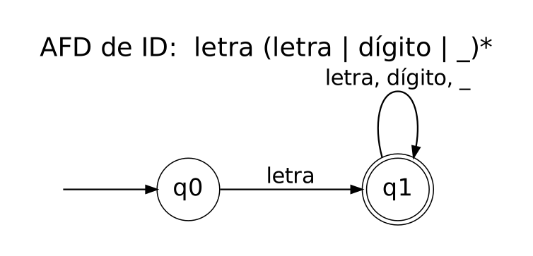
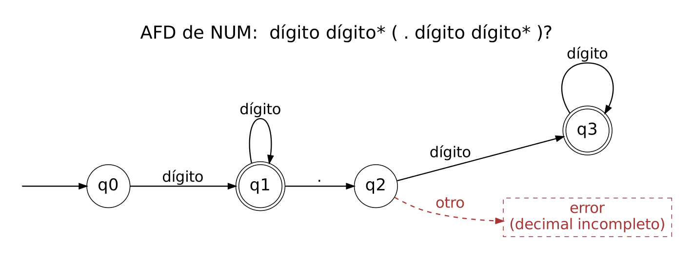
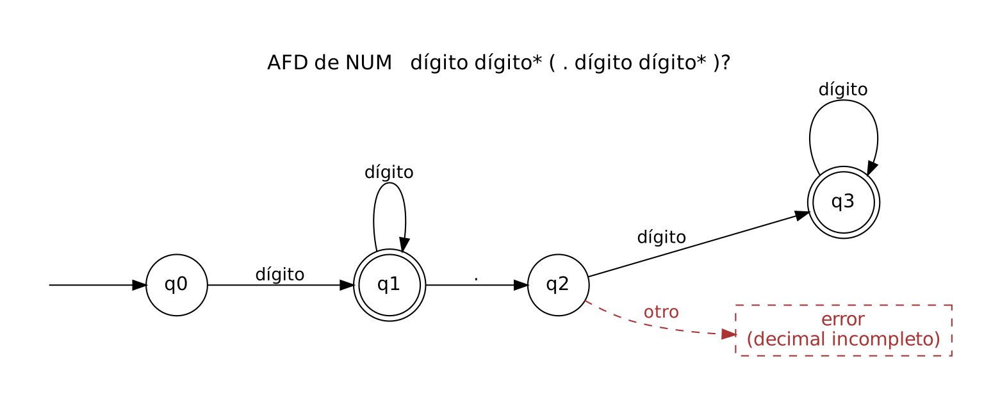
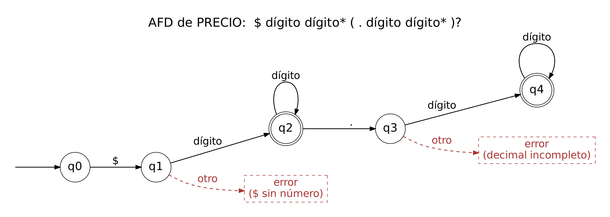
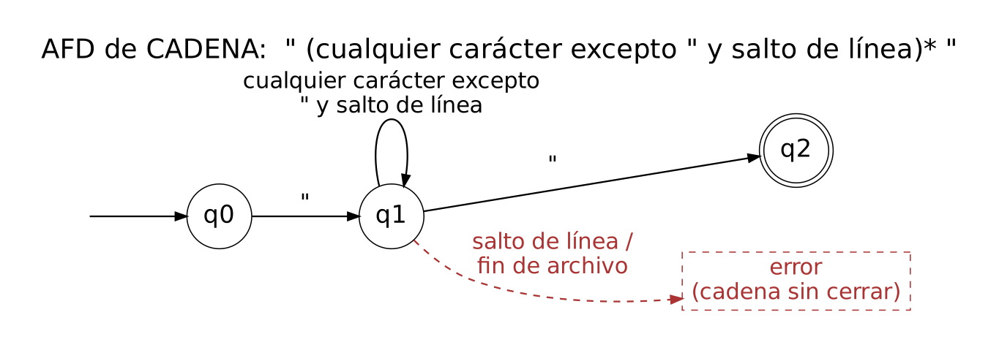
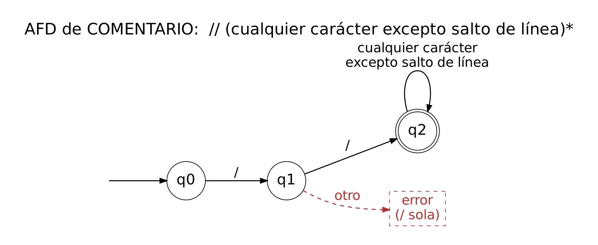
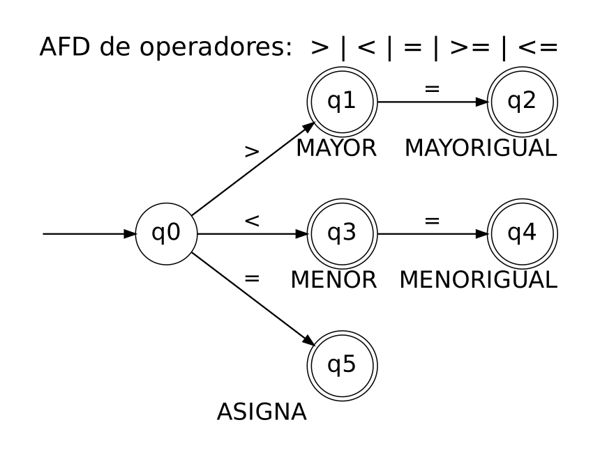

# Haroldmart · Lenguaje de promociones para supermercados — Entrega final (P2)

**Compiladores (IDS601) · 6.º semestre · UNEDL 2026B** · Harold Figueroa Márquez · proyecto individual

**Repositorio en GitHub:** [https://github.com/HaroldDevOS05/haroldmart-compilador-avance2](https://github.com/HaroldDevOS05/haroldmart-compilador-avance2)

Haroldmart es un lenguaje para que el administrador de un supermercado escriba sus promociones **en español** y un compilador las
**revise** antes de que la caja las aplique. Este repositorio es el analizador completo: **escáner** (un AFD por token), **parser LL(1)**
descendente recursivo con recuperación de errores, **tabla de símbolos** con tipos declarados y funciones predefinidas, **comprobación de
tipos**, y además la parte de traducción (postfija, código de tres direcciones, esquema de traducción y un intérprete que aplica las promociones a una venta de prueba).

**Contenido:** [1 Negocio](#1-mi-negocio-para-quién-es-y-cuánto-pagaría) · [2 Cómo correrlo](#2-cómo-correrlo) · [3 Tokens, ER y AFD](#3-tokens-expresiones-regulares-y-afd) ·
[4 Gramática](#4-gramática-ll1-final-versión-4) · [5 Verificación](#5-verificación-de-la-gramática) · [6 FIRST, FOLLOW y tabla LL(1)](#6-first-follow-y-tabla-ll1) ·
[7 Comparación](#7-comparación-con-versiones-malas-de-la-gramática) · [8 Parser y errores](#8-parser-y-recuperación-de-errores) · [9 Igualdad](#9-comparación-de-igualdad--y-) ·
[10 Declaraciones y tabla de símbolos](#10-declaraciones-y-tabla-de-símbolos) · [11 Funciones](#11-funciones-predefinidas) · [12 Comprobación de tipos](#12-comprobación-de-tipos) ·
[13 Analizador completo](#13-el-analizador-completo-analizar_todopy) · [14 Ejemplos con errores](#14-ejemplos-con-errores-y-su-salida) ·
[15 Traducción](#15-árbol-postfija-y-código-de-tres-direcciones) · [16 Esquema de traducción](#16-esquema-de-traducción) · [17 Intérprete](#17-atributos-y-aplicación-de-las-promociones) ·
[18 Pruebas cruzadas](#18-pruebas-cruzadas) · [19 Guía de defensa](#19-guía-para-la-defensa-con-mi-propio-código) · [20 Lo que sabemos que falta](#20-lo-que-sabemos-que-falta) ·
[21 Cotejo](#21-lista-de-cotejo-de-la-entrega) · [22 Estructura](#22-estructura-del-repositorio-y-cómo-creció)

---

## 1. Mi negocio: para quién es y cuánto pagaría

**Para quién es.** Para el administrador de un supermercado de barrio o de una cadena chica de tiendas. Hoy esa persona cambia las promociones cada
semana (descuento por monto de compra, envío gratis, precio de mayoreo, descuento para adultos mayores, canje de puntos) **a mano** o **pidiéndole a un programador**
que mueva el sistema de la caja. Con Haroldmart el encargado escribe el lunes, por ejemplo,

```
SI total_compra > $1000 ENTONCES descuento = total_compra * 5%
```

y el compilador **revisa la regla antes de que llegue a la caja**: que no tenga símbolos raros, que esté bien armada, que cada dato esté declarado,
que la función exista y que las cuentas tengan sentido (no se suma un porcentaje con dinero). Así nadie se equivoca al cobrar y el descuento de adultos mayores siempre se respeta.

**Cuánto pagaría y por qué.** Propongo una **cuota de $600 MXN al mes por tienda**, con cambios de reglas ilimitados. El razonamiento: un solo cambio de promoción hecho
por un programador externo cuesta algo parecido a esa cantidad, y una tienda cambia sus promociones cada semana; con la cuota mensual el supermercado deja de depender de nadie
para esos cambios y, además, evita el costo de cobrar mal (descuentos que no se aplican o que se aplican de más). Para una cadena de 5 tiendas serían $3,000 al mes. *(La cifra es un
supuesto de negocio mío para el proyecto, no un dato medido; el lenguaje y el compilador no dependen de ella.)*

**Un archivo real de promociones** (`pruebas/promos_v4.txt`), con declaraciones, funciones e igualdad:

```
// Promociones de Haroldmart, versión FINAL: declaraciones, funciones predefinidas e igualdad
// Datos que manda la caja (datos de la venta)
dinero total_compra
numero km
numero piezas
numero edad
numero puntos
texto tipo_cliente
// Datos que calculan las reglas (resultados)
porcentaje tasa
dinero descuento
dinero envio
dinero precio_unitario
dinero cotizacion
dinero pago
dinero ahorro
texto mensaje

// 1) Descuento por monto: 5% si la compra pasa de $1000. Clientes frecuentes (igualdad ==) 10%
tasa = 5%
SI tipo_cliente == "frecuente" ENTONCES tasa = 10%
SI total_compra > $1000 ENTONCES descuento = redondear(total_compra * tasa) SINO descuento = $0
// 2) Envío gratis desde $500; si no, $2 por kilómetro más una cuota fija de $30
SI total_compra >= $500 ENTONCES envio = $0 SINO envio = km * 2 + $30
// 3) Cotización de mayoreo (más de 100 piezas) y pago final con tope de ahorro
SI piezas > 100 ENTONCES precio_unitario = $8.50 SINO precio_unitario = $10
cotizacion = precio_unitario * piezas
ahorro = minimo(redondear(total_compra * tasa), $150)
pago = aplicar_descuento(total_compra, tasa) + envio
// 4) Adultos mayores: 15% de descuento sobre el pago
SI edad >= 60 ENTONCES pago = aplicar_descuento(pago, 15%)
// 5) Monedero Haroldmart: se canjean 100 puntos por vuelta
MIENTRAS puntos > 100 HACER puntos = puntos - 100
// 6) Mensaje para el cajero (los clientes que NO son de mostrador)
mensaje = "Promoción aplicada"
SI tipo_cliente != "mostrador" ENTONCES ESCRIBIR mensaje
```

La **venta de prueba** es lo que mandaría la caja: `total_compra`, `km`, `piezas`, `edad`, `puntos` y `tipo_cliente`. Hay dos ventas (en `src/evaluar_atributos.py`): la *grande*
(`$1200`, 4 km, 120 piezas, 65 años, 250 puntos, cliente `"frecuente"`) y la *chica* (`$320`, 4 km, 30 piezas, 30 años, 80 puntos). Son datos inventados.

## 2. Cómo correrlo

Se necesita **Python 3** (sin librerías externas). En Windows el comando suele ser `python`; en Linux/Mac, `python3`. Desde la carpeta del proyecto:

```
python src/analizar_todo.py pruebas/promos_v4.txt --tabla         # el analizador completo (4 fases): programa correcto
python src/analizar_todo.py pruebas/promos_v4_tipos.txt           # con errores de tipo
python src/analizar_todo.py pruebas/final_error_lexico.txt --tabla      # programa con errores léxicos
python src/analizar_todo.py pruebas/final_error_sintactico.txt --tabla  # programa con errores sintácticos
python src/escaner_v4.py pruebas/promos_v4.txt                    # solo el escáner: tokens con su línea (agrega --traza para ver los estados del AFD)
python src/parser_v4.py pruebas/promos_v4.txt --arbol             # solo el parser: imprime el árbol
python src/evaluar_atributos.py pruebas/promos_v4.txt --venta grande   # aplica las promociones a una venta (también --venta chica y --anotado)
python src/verificar_gramatica.py --tabla                         # verifica la gramática: recursión izquierda, conflictos LL(1) y SLR
python src/pruebas_cruzadas.py                                    # comprueba unas piezas contra otras
bash correr_todo.sh                                               # corre TODO y guarda cada salida en salidas/
```

**Para probar una regla nueva sin cambiar el código:** escribirla en un archivo `.txt` (declarando antes sus datos) y pasárselo a `analizar_todo.py`.
Los errores salen con su número de línea y el análisis **no se detiene** en el primero.
`analizar_todo.py` acepta cualquier regla nueva **sin cambiar el código**. Si además se quiere **ejecutar** con `evaluar_atributos.py`, los datos de la regla deben existir en la venta de prueba
(`VENTAS`, al inicio de ese archivo): con un dato nuevo, como `litros_leche`, el intérprete avisa `la venta no trae el dato 'litros_leche'` y basta agregarlo a la venta (son datos, no lógica).

## 3. Tokens, expresiones regulares y AFD

Un **AFD por token**, guiado por una tabla `tabla[estado][clase de carácter]`; el escáner se queda con el lexema **más largo** y no se detiene en un error léxico: lo anota con su línea y sigue.
La primera letra de un lexema decide qué AFD se usa.

| Token | Expresión regular | Ejemplos |
|---|---|---|
| Palabras reservadas: `CASO`, `CONTINUAR`, `ENTONCES`, `ESCRIBIR`, `FIN`, `FUNCION`, `HACER`, `LEER`, `MIENTRAS`, `PARA`, `PROCEDIMIENTO`, `RETORNAR`, `ROMPER`, `SEGUN`, `SI`, `SINO` | la palabra exacta, en mayúsculas | `SI`, `HACER` |
| `TIPO` | `numero \| dinero \| porcentaje \| texto` (se lee como `ID` y se convierte) | `dinero` |
| `ID` | `letra (letra \| dígito \| _)*` | `total_compra`, `descuento_5` |
| `NUM` | `dígito+ ( . dígito+ )?` | `10`, `0.5` |
| `PRECIO` | `$ dígito+ ( . dígito+ )?` | `$1000`, `$8.50` |
| `PORC` | `dígito+ ( . dígito+ )? %` | `15%`, `5%` |
| `CADENA` | `" (cualquier carácter excepto " y salto de línea)* "` | `"frecuente"` |
| `MAYOR` `MENOR` `MAYORIGUAL` `MENORIGUAL` | `>` `<` `>=` `<=` | |
| `ASIGNA` | `=` | |
| `IGUAL` `DIFERENTE` | `==` `!=` | `tipo_cliente == "frecuente"` |
| `MAS` `MENOS` `POR` `ENTRE` | `+` `-` `*` `/` | |
| `PARIZQ` `PARDER` `COMA` | `(` `)` `,` | `minimo(a, b)` |
| (se ignoran) | espacios, tabs, saltos de línea, comentarios `// ...` | |

**Palabra reservada o `ID`.** `SI` y las demás reservadas se leen con el AFD de `ID` (son letras) y **después** se compara el lexema con la tabla de palabras reservadas;
si está, el token toma ese nombre. Lo mismo pasa con `dinero`, `numero`... que se vuelven `TIPO`. Por eso no hace falta un AFD por cada palabra.

**AFD de `ID`** (`letra (letra | dígito | _)*`): clases de carácter *letra*, *dígito* y `_`.

| Estado | Transiciones | ¿Qué es? |
|---|---|---|
| q0 | `letra` → q1 | inicio |
| q1 | `letra` → q1, `digito` → q1, `_` → q1 | **acepta ID** |


**AFD de `NUM`** (`dígito+ ( . dígito+ )?`): `q2` es un estado de error, porque `12.` termina en un decimal incompleto. El mismo AFD reconoce `PORC`: un `%` justo después del número lleva a `q5`.

| Estado | Transiciones | ¿Qué es? |
|---|---|---|
| q0 | `digito` → q1 | inicio |
| q1 | `digito` → q1, `.` → q2, `%` → q5 | **acepta NUM** |
| q2 | `digito` → q3 | **error léxico** |
| q3 | `digito` → q3, `%` → q5 | **acepta NUM** |
| q5 | (ninguna) | **acepta PORC** |


**AFD de `PRECIO`** (`$ dígito+ ( . dígito+ )?`): un `$` solo es error léxico.

| Estado | Transiciones | ¿Qué es? |
|---|---|---|
| q0 | `$` → q1 | inicio |
| q1 | `digito` → q2 | **error léxico** |
| q2 | `digito` → q2, `.` → q3 | **acepta PRECIO** |
| q3 | `digito` → q4 | **error léxico** |
| q4 | `digito` → q4 | **acepta PRECIO** |


**AFD de `CADENA`**:

| Estado | Transiciones | ¿Qué es? |
|---|---|---|
| q0 | `"` → q1 | inicio |
| q1 | `"` → q2, `
` → None, `
` → None, `*` → q1 | **error léxico** |
| q2 | (ninguna) | **acepta CADENA** |


**AFD de comentarios** (`//` se ignora; una `/` sola es el token `ENTRE`):

| Estado | Transiciones | ¿Qué es? |
|---|---|---|
| q0 | `/` → q1 | inicio |
| q1 | `/` → q2 | **acepta ENTRE** |
| q2 | `
` → None, `
` → None, `*` → q2 | **acepta IGNORAR** |


**AFD de operadores de comparación** (con `==` y `!=`). Como el escáner toma el lexema más largo, `==` es `IGUAL` (no dos `ASIGNA`) y `=` solo es `ASIGNA`; una `!` sola es error léxico:

| Estado | Transiciones | ¿Qué es? |
|---|---|---|
| q0 | `>` → q1, `<` → q3, `=` → q5, `!` → q7 | inicio |
| q1 | `=` → q2 | **acepta MAYOR** |
| q2 | (ninguna) | **acepta MAYORIGUAL** |
| q3 | `=` → q4 | **acepta MENOR** |
| q4 | (ninguna) | **acepta MENORIGUAL** |
| q5 | `=` → q6 | **acepta ASIGNA** |
| q6 | (ninguna) | **acepta IGUAL** |
| q7 | `=` → q8 | **error léxico** |
| q8 | (ninguna) | **acepta DIFERENTE** |


**AFD de aritméticos y coma** (`+ - * ( ) ,`; la `/` va en el AFD de comentarios):

| Estado | Transiciones | ¿Qué es? |
|---|---|---|
| q0 | `+` → q1, `-` → q2, `*` → q3, `(` → q4, `)` → q5, `,` → q6 | inicio |
| q1 | (ninguna) | **acepta MAS** |
| q2 | (ninguna) | **acepta MENOS** |
| q3 | (ninguna) | **acepta POR** |
| q4 | (ninguna) | **acepta PARIZQ** |
| q5 | (ninguna) | **acepta PARDER** |
| q6 | (ninguna) | **acepta COMA** |


**Dibujos de los AFD** (los del Avance 1; las extensiones de las versiones 2 a 4 —`%`, `==`, `!=`, `/` y la coma— están en las tablas de arriba):

| | |
|---|---|
|  |  |
|  |  |
|  |  |
|  | |

**Un token estado por estado** (`pruebas/defensa_afd.txt`, con `python src/escaner_v4.py pruebas/defensa_afd.txt --traza`):

```
LÍNEA TOKEN         LEXEMA                      RECORRIDO DEL AFD
2     SI            SI                          q0→q1→q1
2     ID            total_compra                q0→q1→q1→q1→q1→q1→q1→q1→q1→q1→q1→q1→q1
2     MAYORIGUAL    >=                          q0→q1→q2
2     PRECIO        $1000.50                    q0→q1→q2→q2→q2→q2→q3→q4→q4

Total de tokens: 4
Sin errores léxicos.
```

Cada `q` es un estado; el recorrido de `total_compra` es `q0 → q1` (la `t`) y después 11 veces `q1 → q1` (el resto de las letras y el `_`), y acepta en `q1` porque es un estado de aceptación de `ID`.

## 4. Gramática LL(1) final (versión 4)

Un programa es una lista de reglas. Una regla puede ser una **declaración** (`dinero total_compra`), una condición (`SI … ENTONCES … [SINO …]`), un ciclo (`MIENTRAS … HACER …`), una asignación o un mensaje (`ESCRIBIR`).
Un valor es una **expresión** con `+ - * /`, paréntesis y **llamadas a funciones**. ε significa «vacío».

```
   1. Programa → Regla Programa
   2. Programa → ε
   3. Regla → Decl
   4. Regla → Si
   5. Regla → Mientras
   6. Regla → Asig
   7. Regla → Escribir
   8. Decl → TIPO ID
   9. Si → SI Cond ENTONCES Accion Sino
  10. Sino → SINO Accion
  11. Sino → ε
  12. Mientras → MIENTRAS Cond HACER Accion
  13. Accion → Asig
  14. Accion → Escribir
  15. Asig → ID ASIGNA Valor
  16. Escribir → ESCRIBIR Valor
  17. Cond → ID Oprel Valor
  18. Oprel → MAYOR
  19. Oprel → MENOR
  20. Oprel → MAYORIGUAL
  21. Oprel → MENORIGUAL
  22. Oprel → IGUAL
  23. Oprel → DIFERENTE
  24. Valor → Expr
  25. Expr → Term ExprR
  26. ExprR → MAS Term ExprR
  27. ExprR → MENOS Term ExprR
  28. ExprR → ε
  29. Term → Factor TermR
  30. TermR → POR Factor TermR
  31. TermR → ENTRE Factor TermR
  32. TermR → ε
  33. Factor → NUM
  34. Factor → PRECIO
  35. Factor → PORC
  36. Factor → CADENA
  37. Factor → ID Llamada
  38. Factor → PARIZQ Expr PARDER
  39. Llamada → PARIZQ Args PARDER
  40. Llamada → ε
  41. Args → Expr ArgsR
  42. Args → ε
  43. ArgsR → COMA Expr ArgsR
  44. ArgsR → ε

```

Decisiones de diseño (todas para que sea LL(1)):

- **Sin recursión izquierda:** la lista de reglas es `Programa → Regla Programa | ε`; las expresiones usan `ExprR` y `TermR` (la asociatividad izquierda `a - b - c = (a - b) - c` se recupera con un ciclo `while` en el parser).
- **Precedencia por la estructura:** `*` y `/` están en `Term` (más abajo), así que se agrupan antes que `+` y `-`.
- **Sin ambigüedad del `SINO`:** `Si → SI Cond ENTONCES Accion Sino` con `Sino → SINO Accion | ε`; como la acción nunca es otro `Si`, el `SINO` pertenece al `SI` inmediato anterior.
- **Factorizar la llamada:** `ID` (variable) e `ID ( … )` (llamada) empiezan igual; se factoriza con `Factor → ID Llamada` y `Llamada → ( Args ) | ε`. El parser decide **mirando un token más adelante** (si después del `ID` viene `(`).
- **`TIPO` no está en ningún otro FIRST**, así que la declaración no rompe nada; y `TIPO` entra a FOLLOW(`Sino`) para que un `SI` sin `SINO` pueda ir seguido de una declaración.
- Los **operadores de comparación** están agrupados en `Oprel` (ahora con `IGUAL` y `DIFERENTE`).

## 5. Verificación de la gramática

Salida real de `python src/verificar_gramatica.py` (el `verificar_base.py` del profesor con mi gramática). La primera es la **final**; las demás son las versiones anteriores y las comparaciones de la sección 7.

```
== MI GRAMÁTICA v4 (final, con llamadas a funciones e igualdad) (44 reglas)
   Recursión izquierda: no
   Conflictos LL(1):    0
   Conflictos SLR:      0 (en 72 estados)
   → SIRVE para nuestro parser LL(1) · SIRVE para SLR
== Versión 3 (Entrega final día 1, con declaraciones) (36 reglas)
   Recursión izquierda: no
   Conflictos LL(1):    0
   Conflictos SLR:      0 (en 61 estados)
   → SIRVE para nuestro parser LL(1) · SIRVE para SLR
== Versión 2 (Avance 3, con operaciones, sin declaraciones) (34 reglas)
   Recursión izquierda: no
   Conflictos LL(1):    0
   Conflictos SLR:      0 (en 58 estados)
   → SIRVE para nuestro parser LL(1) · SIRVE para SLR
== Versión 1 (Avance 2, sin operaciones) (22 reglas)
   Recursión izquierda: no
   Conflictos LL(1):    0
   Conflictos SLR:      0 (en 36 estados)
   → SIRVE para nuestro parser LL(1) · SIRVE para SLR
== VERSIÓN A: con recursión izquierda en la lista de reglas (Programa → Programa Regla) (44 reglas)
   Recursión izquierda: Programa
   Conflictos LL(1):    5
      celda [Programa, ESCRIBIR]: reglas 1, 2
      celda [Programa, ID]: reglas 1, 2
      celda [Programa, MIENTRAS]: reglas 1, 2
   Conflictos SLR:      0 (en 71 estados)
   → NO sirve para LL(1) · SIRVE para SLR
== VERSIÓN B: sin factorizar el SINO (dos reglas Si que empiezan igual) (43 reglas)
   Recursión izquierda: no
   Conflictos LL(1):    1
      celda [Si, SI]: reglas 42, 43
   Conflictos SLR:      0 (en 71 estados)
   → NO sirve para LL(1) · SIRVE para SLR
== VERSIÓN C: Expr con recursión izquierda (Expr → Expr + Term, Term → Term * Factor) (42 reglas)
   Recursión izquierda: Expr, Term
   Conflictos LL(1):    12
      celda [Expr, CADENA]: reglas 25, 26, 27
      celda [Expr, ID]: reglas 25, 26, 27
      celda [Expr, NUM]: reglas 25, 26, 27
   Conflictos SLR:      0 (en 66 estados)
   → NO sirve para LL(1) · SIRVE para SLR
== VERSIÓN D: llamada sin factorizar (Factor → ID | ID ( Args )) (43 reglas)
   Recursión izquierda: no
   Conflictos LL(1):    1
      celda [Factor, ID]: reglas 42, 43
   Conflictos SLR:      0 (en 71 estados)
   → NO sirve para LL(1) · SIRVE para SLR

```

**Mi gramática final: sin recursión izquierda, 0 conflictos LL(1) y 0 conflictos SLR.**

## 6. FIRST, FOLLOW y tabla LL(1)

```
FIRST:
  FIRST(Programa) = { TIPO, ID, SI, MIENTRAS, ESCRIBIR, ε }
  FIRST(Regla) = { TIPO, ID, SI, MIENTRAS, ESCRIBIR }
  FIRST(Decl) = { TIPO }
  FIRST(Si) = { SI }
  FIRST(Sino) = { SINO, ε }
  FIRST(Mientras) = { MIENTRAS }
  FIRST(Accion) = { ID, ESCRIBIR }
  FIRST(Asig) = { ID }
  FIRST(Escribir) = { ESCRIBIR }
  FIRST(Cond) = { ID }
  FIRST(Oprel) = { MAYOR, MENOR, MAYORIGUAL, MENORIGUAL, IGUAL, DIFERENTE }
  FIRST(Valor) = { ID, NUM, PRECIO, PORC, CADENA, PARIZQ }
  FIRST(Expr) = { ID, NUM, PRECIO, PORC, CADENA, PARIZQ }
  FIRST(ExprR) = { MAS, MENOS, ε }
  FIRST(Term) = { ID, NUM, PRECIO, PORC, CADENA, PARIZQ }
  FIRST(TermR) = { POR, ENTRE, ε }
  FIRST(Factor) = { ID, NUM, PRECIO, PORC, CADENA, PARIZQ }
  FIRST(Llamada) = { PARIZQ, ε }
  FIRST(Args) = { ID, NUM, PRECIO, PORC, CADENA, PARIZQ, ε }
  FIRST(ArgsR) = { COMA, ε }

FOLLOW:
  FOLLOW(Programa) = { $ }
  FOLLOW(Regla) = { TIPO, ID, SI, MIENTRAS, ESCRIBIR, $ }
  FOLLOW(Decl) = { TIPO, ID, SI, MIENTRAS, ESCRIBIR, $ }
  FOLLOW(Si) = { TIPO, ID, SI, MIENTRAS, ESCRIBIR, $ }
  FOLLOW(Sino) = { TIPO, ID, SI, MIENTRAS, ESCRIBIR, $ }
  FOLLOW(Mientras) = { TIPO, ID, SI, MIENTRAS, ESCRIBIR, $ }
  FOLLOW(Accion) = { TIPO, ID, SI, SINO, MIENTRAS, ESCRIBIR, $ }
  FOLLOW(Asig) = { TIPO, ID, SI, SINO, MIENTRAS, ESCRIBIR, $ }
  FOLLOW(Escribir) = { TIPO, ID, SI, SINO, MIENTRAS, ESCRIBIR, $ }
  FOLLOW(Cond) = { ENTONCES, HACER }
  FOLLOW(Oprel) = { ID, NUM, PRECIO, PORC, CADENA, PARIZQ }
  FOLLOW(Valor) = { TIPO, ID, SI, ENTONCES, SINO, MIENTRAS, HACER, ESCRIBIR, $ }
  FOLLOW(Expr) = { TIPO, ID, SI, ENTONCES, SINO, MIENTRAS, HACER, ESCRIBIR, PARDER, COMA, $ }
  FOLLOW(ExprR) = { TIPO, ID, SI, ENTONCES, SINO, MIENTRAS, HACER, ESCRIBIR, PARDER, COMA, $ }
  FOLLOW(Term) = { TIPO, ID, SI, ENTONCES, SINO, MIENTRAS, HACER, ESCRIBIR, MAS, MENOS, PARDER, COMA, $ }
  FOLLOW(TermR) = { TIPO, ID, SI, ENTONCES, SINO, MIENTRAS, HACER, ESCRIBIR, MAS, MENOS, PARDER, COMA, $ }
  FOLLOW(Factor) = { TIPO, ID, SI, ENTONCES, SINO, MIENTRAS, HACER, ESCRIBIR, MAS, MENOS, POR, ENTRE, PARDER, COMA, $ }
  FOLLOW(Llamada) = { TIPO, ID, SI, ENTONCES, SINO, MIENTRAS, HACER, ESCRIBIR, MAS, MENOS, POR, ENTRE, PARDER, COMA, $ }
  FOLLOW(Args) = { PARDER }
  FOLLOW(ArgsR) = { PARDER }

```

Tabla LL(1): cada celda es el número de la regla de la sección 4 que se usa; **celda vacía = error sintáctico**. Ninguna celda tiene dos reglas, por eso es LL(1).

| | TIPO | ID | SI | ENTONCES | SINO | MIENTRAS | HACER | ASIGNA | ESCRIBIR | MAYOR | MENOR | MAYORIGUAL | MENORIGUAL | IGUAL | DIFERENTE | MAS | MENOS | POR | ENTRE | NUM | PRECIO | PORC | CADENA | PARIZQ | PARDER | COMA | $ |
|---|:-:|:-:|:-:|:-:|:-:|:-:|:-:|:-:|:-:|:-:|:-:|:-:|:-:|:-:|:-:|:-:|:-:|:-:|:-:|:-:|:-:|:-:|:-:|:-:|:-:|:-:|:-:|
| **Programa** | 1 | 1 | 1 |   |   | 1 |   |   | 1 |   |   |   |   |   |   |   |   |   |   |   |   |   |   |   |   |   | 2 |
| **Regla** | 3 | 6 | 4 |   |   | 5 |   |   | 7 |   |   |   |   |   |   |   |   |   |   |   |   |   |   |   |   |   |   |
| **Decl** | 8 |   |   |   |   |   |   |   |   |   |   |   |   |   |   |   |   |   |   |   |   |   |   |   |   |   |   |
| **Si** |   |   | 9 |   |   |   |   |   |   |   |   |   |   |   |   |   |   |   |   |   |   |   |   |   |   |   |   |
| **Sino** | 11 | 11 | 11 |   | 10 | 11 |   |   | 11 |   |   |   |   |   |   |   |   |   |   |   |   |   |   |   |   |   | 11 |
| **Mientras** |   |   |   |   |   | 12 |   |   |   |   |   |   |   |   |   |   |   |   |   |   |   |   |   |   |   |   |   |
| **Accion** |   | 13 |   |   |   |   |   |   | 14 |   |   |   |   |   |   |   |   |   |   |   |   |   |   |   |   |   |   |
| **Asig** |   | 15 |   |   |   |   |   |   |   |   |   |   |   |   |   |   |   |   |   |   |   |   |   |   |   |   |   |
| **Escribir** |   |   |   |   |   |   |   |   | 16 |   |   |   |   |   |   |   |   |   |   |   |   |   |   |   |   |   |   |
| **Cond** |   | 17 |   |   |   |   |   |   |   |   |   |   |   |   |   |   |   |   |   |   |   |   |   |   |   |   |   |
| **Oprel** |   |   |   |   |   |   |   |   |   | 18 | 19 | 20 | 21 | 22 | 23 |   |   |   |   |   |   |   |   |   |   |   |   |
| **Valor** |   | 24 |   |   |   |   |   |   |   |   |   |   |   |   |   |   |   |   |   | 24 | 24 | 24 | 24 | 24 |   |   |   |
| **Expr** |   | 25 |   |   |   |   |   |   |   |   |   |   |   |   |   |   |   |   |   | 25 | 25 | 25 | 25 | 25 |   |   |   |
| **ExprR** | 28 | 28 | 28 | 28 | 28 | 28 | 28 |   | 28 |   |   |   |   |   |   | 26 | 27 |   |   |   |   |   |   |   | 28 | 28 | 28 |
| **Term** |   | 29 |   |   |   |   |   |   |   |   |   |   |   |   |   |   |   |   |   | 29 | 29 | 29 | 29 | 29 |   |   |   |
| **TermR** | 32 | 32 | 32 | 32 | 32 | 32 | 32 |   | 32 |   |   |   |   |   |   | 32 | 32 | 30 | 31 |   |   |   |   |   | 32 | 32 | 32 |
| **Factor** |   | 37 |   |   |   |   |   |   |   |   |   |   |   |   |   |   |   |   |   | 33 | 34 | 35 | 36 | 38 |   |   |   |
| **Llamada** | 40 | 40 | 40 | 40 | 40 | 40 | 40 |   | 40 |   |   |   |   |   |   | 40 | 40 | 40 | 40 |   |   |   |   | 39 | 40 | 40 | 40 |
| **Args** |   | 41 |   |   |   |   |   |   |   |   |   |   |   |   |   |   |   |   |   | 41 | 41 | 41 | 41 | 41 | 42 |   |   |
| **ArgsR** |   |   |   |   |   |   |   |   |   |   |   |   |   |   |   |   |   |   |   |   |   |   |   |   | 44 | 43 |   |


**Cómo se lee una celda.** `python src/consultar_tabla.py Sino '$'` explica por qué el parser elige esa regla:

```
Celda [Sino, $] = regla 11
  Regla 11: Sino → ε  porque el lado derecho puede ser vacío y «$» está en FOLLOW(Sino) = { $, ESCRIBIR, ID, MIENTRAS, SI, TIPO }
Celda [Sino, SINO] = regla 10
  Regla 10: Sino → SINO Accion  porque «SINO» está en FIRST(SINO Accion) = { SINO }
Celda [Factor, ID] = regla 37
  Regla 37: Factor → ID Llamada  porque «ID» está en FIRST(ID Llamada) = { ID }
Celda [Si, ENTONCES] VACÍA → error de sintaxis. Con Si se esperaba: SI
Celda [Programa, SINO] VACÍA → error de sintaxis. Con Programa se esperaba: $, ESCRIBIR, ID, MIENTRAS, SI, TIPO
```

## 7. Comparación con versiones «malas» de la gramática

| Versión | Recursión izquierda | Conflictos LL(1) | Conflictos SLR |
|---|---|---|---|
| **Final v4** | no | **0** | **0** (72 estados) |
| **A**: `Programa → Programa Regla \| ε` | sí (`Programa`) | 5 | 0 |
| **B**: `Si` sin factorizar (`SI … Accion` y `SI … Accion SINO Accion`) | no | 1 (`[Si, SI]`) | 0 |
| **C**: `Expr → Expr + Term`, `Term → Term * Factor` | sí (`Expr`, `Term`) | 12 | 0 (66 estados) |
| **D**: llamada sin factorizar (`Factor → ID \| ID ( Args )`) | no | 1 (`[Factor, ID]`) | 0 |

**Por qué LR sí acepta A, B, C y D y LL(1) no.** Un parser LL(1) decide qué regla usar mirando *un solo token antes de empezar* el no terminal. En `Expr → Expr + Term | Term`,
con un `ID` las dos reglas empiezan igual (conflicto) y la función `expr()` se llamaría a sí misma sin consumir nada: recursión infinita. Un parser LR apila símbolos y *reduce* hasta
ver el lado derecho completo, así que no adivina al principio y la recursión izquierda no lo cicla (incluso le conviene: `Expr → Expr + Term` ya agrupa por la izquierda). Con las versiones B y D
las dos reglas empiezan igual y en LL(1) hay que **factorizar** (sacar lo común: `Sino`, `Llamada`); el parser LR espera a ver más antes de reducir. **LALR(1)** (el método de yacc/bison) une los estados LR
con el mismo núcleo: tabla tan chica como la SLR pero más precisa; acepta más gramáticas que LL(1) y se usa porque esas herramientas *generan* el parser, mientras que el LL(1) a mano se escribe una función por no terminal.

## 8. Parser y recuperación de errores

El parser es **descendente recursivo**: **una función por cada no terminal**, y cada una decide qué regla usar mirando el token actual (según la tabla LL(1)). Se construyó en capas, y cada capa **hereda** de la anterior:

| Archivo | Qué agrega |
|---|---|
| `parser_Haroldmart.py` | parser base (una función por no terminal); se detiene en el **primer** error |
| `parser_con_recuperacion.py` | **modo pánico** (salta hasta el inicio de la siguiente regla), **nivel de frase** (si falta `ENTONCES` o `HACER` lo supone y sigue) y errores léxicos + sintácticos juntos, ordenados por línea |
| `parser_v2.py` | expresiones `+ - * /` y paréntesis (`expr()`, `term()`, `factor()` con ciclos `while`) |
| `parser_v3.py` | declaraciones (`Decl → TIPO ID`) |
| `parser_v4.py` | llamadas a funciones (`Llamada`, `Args`) y los operadores `==` / `!=` |

- **Árbol de sintaxis abstracta:** cada operación es un nodo (`*`, `+`...) con sus dos operandos como hijos; los paréntesis solo agrupan y no son nodo; una llamada es un nodo `Llamada` con un hijo por dato.
- **Errores en cascada:** un error de sintaxis en un renglón que **ya tiene un error léxico** se omite (es consecuencia del símbolo desconocido) y se avisa cuántos fueron.
- **Mensajes** en palabras del negocio («se esperaba un operador de comparación», «se esperaba un valor»), siempre con la línea.

Árbol de una regla con funciones anidadas (`ahorro = minimo(redondear(total_compra * tasa), $150)`):

```
├─ Regla
│  └─ Decl
│     ├─ TIPO: dinero
│     └─ ID: ahorro
```

## 9. Comparación de igualdad (`==` y `!=`)

**Decisión: sí la agregué.** Sin ella no se puede escribir una regla como «si el cliente es frecuente». Cambios:

- **Escáner:** el AFD de operadores tiene los estados nuevos `q5 → q6` (`==`, `IGUAL`) y `q7 → q8` (`!=`, `DIFERENTE`); una `!` sola es error léxico.
- **Gramática:** `Oprel → IGUAL | DIFERENTE` (reglas 22 y 23); no cambia nada más y sigue siendo LL(1).
- **Tipos:** `==` y `!=` comparan tipos iguales (y `numero` con `dinero`); el **texto solo se compara con `==` y `!=`**, no con `>` o `<`.
- **Intérprete:** `SI tipo_cliente == "frecuente" ENTONCES tasa = 10%` se evalúa con la venta (en la venta grande el cliente es `"frecuente"` y la tasa pasa de 5% a 10%).

## 10. Declaraciones y tabla de símbolos

El administrador **declara** cada dato y su tipo **antes** de usarlo (como dar de alta un producto antes de venderlo): `dinero total_compra`, `numero km`, `porcentaje tasa`, `texto mensaje`.
Los tipos del negocio son `numero`, `dinero`, `porcentaje` y `texto`. Una declaración vale en **todo el archivo** (alcance global), pero hay que declarar **antes de usar**.

La **tabla de símbolos** guarda por variable: **nombre**, **tipo declarado**, **clase**, **línea donde se declara**, **líneas donde se asigna** y **líneas donde se usa**.
La clase sale del uso: *dato de la venta* = declarada y nunca asignada (la manda la caja); *resultado* = la calcula una regla; *dato y resultado* = viene de la caja y una regla lo cambia (`puntos = puntos - 100`).

`python src/analizar_todo.py pruebas/promos_v4.txt --tabla`:

```
Fase 1 · Léxico:        145 tokens, 0 error(es)
Fase 2 · Sintaxis:      26 reglas, 0 error(es)
Fase 3 · Declaraciones: 14 variables, 3 funciones, 0 error(es)
Fase 4 · Tipos:         0 error(es)
RESULTADO: programa correcto ✓

Nombre             Tipo        Clase             Declarada  Asignada en  Usada en
total_compra       dinero      dato de la venta  3          —            22, 24, 28, 29
km                 numero      dato de la venta  4          —            24
piezas             numero      dato de la venta  5          —            26, 27
edad               numero      dato de la venta  6          —            31
puntos             numero      dato y resultado  7          33           33
tipo_cliente       texto       dato de la venta  8          —            21, 36
tasa               porcentaje  resultado         10         20, 21       22, 28, 29
descuento          dinero      resultado         11         22           —
envio              dinero      resultado         12         24           29
precio_unitario    dinero      resultado         13         26           27
cotizacion         dinero      resultado         14         27           —
pago               dinero      resultado         15         29, 31       31
ahorro             dinero      resultado         16         28           —
mensaje            texto       resultado         17         35           36
Total: 14 variables
Función redondear(dinero) → dinero: usada en la(s) línea(s) 22, 28
Función minimo(dinero, dinero) → dinero: usada en la(s) línea(s) 28
Función aplicar_descuento(dinero, porcentaje) → dinero: usada en la(s) línea(s) 29, 31
```

Errores de declaración y de funciones, cada uno con su línea (`pruebas/promos_v4_errores.txt`):

```
// Prueba de errores de DECLARACIÓN y de FUNCIONES (la sintaxis está bien, salvo la última línea)
dinero total_compra
dinero ahorro
dinero total_compra
ahorro = redondear(total_compra, 2)
ahorro = descontar(total_compra)
ahorro = minimo(total_compra)
envio = redondear(total_compra)
ahorro = redondear(total_compra
```

```
Fase 1 · Léxico:        37 tokens, 0 error(es)
Fase 2 · Sintaxis:      7 reglas, 1 error(es)
Fase 3 · Declaraciones: 3 variables, 1 funciones, 5 error(es)
Fase 4 · Tipos:         0 error(es)
  [sintaxis] Línea 9: error de sintaxis, se esperaba «)» y la línea terminó
  [declaración] Línea 4: 'total_compra' ya estaba declarada en la línea 2
  [declaración] Línea 5: 'redondear' recibe 1 dato(s) y le diste 2
  [declaración] Línea 6: no existe la función 'descontar' (hay: redondear, aplicar_descuento, minimo)
  [declaración] Línea 7: 'minimo' recibe 2 dato(s) y le diste 1
  [declaración] Línea 8: 'envio' se usa sin declarar (¿falta «dinero envio»?)
RESULTADO: 6 error(es) en total
```

- **«ya estaba declarada»** (línea 4): se declara dos veces; la tabla se queda con la primera declaración.
- **«se usa sin declarar»** (línea 8): se usa o se asigna una variable que ninguna declaración presentó antes; el mensaje sugiere la declaración que falta.
- Las líneas 5, 6 y 7 son errores de **funciones** (sección 11) y la línea 9 es un error de **sintaxis** (falta `)`): las fases se reportan por separado y ninguna detiene a las demás.

## 11. Funciones predefinidas

Son las «teclas de la caja registradora»: el administrador las **usa** pero no las escribe. Cada una tiene su **firma** (qué datos recibe, de qué tipo, y qué regresa), en `src/funciones.py`:

| Función | Firma | Ejemplo |
|---|---|---|
| `redondear` | `(dinero) → dinero` | `redondear($127.40) = $127` |
| `aplicar_descuento` | `(dinero, porcentaje) → dinero` | `aplicar_descuento($200, 10%) = $180` |
| `minimo` | `(dinero, dinero) → dinero` | `minimo($180, $150) = $150` (sirve de **tope**) |

La tabla de símbolos revisa que **la función exista** y que reciba **el número correcto de datos** (y la comprobación de tipos, que cada dato sea del tipo que pide la firma). Salida con errores (sección 10): `'redondear' recibe 1 dato(s) y le diste 2`, `no existe la función 'descontar'`, `'minimo' recibe 2 dato(s) y le diste 1`.

## 12. Comprobación de tipos

Revisa **sin ejecutar nada** que cada operación tenga sentido (la báscula no acepta litros). El tipo de una expresión se calcula **de las hojas hacia arriba**:
un literal tiene su tipo (`5` numero, `$5` dinero, `5%` porcentaje, `"x"` texto), una variable tiene su **tipo declarado**, una operación consulta la tabla del **sistema de tipos** (lo que no está en la tabla es error),
una llamada devuelve el tipo de su firma, y en una asignación el tipo declarado debe ser **igual** al de lo que se guarda.

```
  +   numero + numero → numero  ·  numero + dinero → dinero  ·  dinero + numero → dinero  ·  dinero + dinero → dinero  ·  porcentaje + porcentaje → porcentaje
  -   numero - numero → numero  ·  numero - dinero → dinero  ·  dinero - numero → dinero  ·  dinero - dinero → dinero  ·  porcentaje - porcentaje → porcentaje
  *   numero * numero → numero  ·  numero * dinero → dinero  ·  numero * porcentaje → numero  ·  dinero * numero → dinero  ·  dinero * porcentaje → dinero  ·  porcentaje * numero → numero  ·  porcentaje * dinero → dinero  ·  porcentaje * porcentaje → porcentaje
  /   numero / numero → numero  ·  numero / porcentaje → numero  ·  dinero / numero → dinero  ·  dinero / dinero → numero  ·  dinero / porcentaje → dinero  ·  porcentaje / numero → porcentaje  ·  porcentaje / porcentaje → numero
  (el texto no se opera con nada; cualquier combinación que no está en la lista es un error de tipo)
```

`python src/analizar_todo.py pruebas/promos_v4_tipos.txt` (todo está declarado y bien escrito; lo que no tiene sentido son las operaciones):

```
// Prueba de errores de TIPO (todo está declarado y bien escrito: lo que no tiene sentido son las operaciones)
dinero total_compra
numero piezas
porcentaje tasa
dinero descuento
dinero envio
texto tipo_cliente
descuento = total_compra + tasa
descuento = tasa
envio = tipo_cliente
SI tipo_cliente > 5 ENTONCES envio = $0
descuento = redondear(tasa)
descuento = total_compra * total_compra
descuento = aplicar_descuento(total_compra, tasa)
SI tipo_cliente == "frecuente" ENTONCES tasa = 10%
```

```
Fase 1 · Léxico:        58 tokens, 0 error(es)
Fase 2 · Sintaxis:      14 reglas, 0 error(es)
Fase 3 · Declaraciones: 6 variables, 2 funciones, 0 error(es)
Fase 4 · Tipos:         6 error(es)
  [tipos] Línea 8: error de tipo, no se puede sumar porcentaje con dinero
  [tipos] Línea 9: error de tipo, 'descuento' es dinero y le quieres guardar porcentaje
  [tipos] Línea 10: error de tipo, 'envio' es dinero y le quieres guardar texto
  [tipos] Línea 11: error de tipo, no se puede comparar texto con numero
  [tipos] Línea 12: error de tipo, el dato 1 de 'redondear' debe ser dinero y es porcentaje
  [tipos] Línea 13: error de tipo, no se puede multiplicar dinero por dinero
RESULTADO: 6 error(es) en total
```

Cada error trae **su línea**: sumar porcentaje con dinero (8), guardar un porcentaje en una variable de dinero (9), guardar texto en dinero (10), comparar texto con `>` (11), pasar un porcentaje a `redondear` (12) y multiplicar dinero por dinero (13).
Las líneas 14 y 15 son correctas (`aplicar_descuento` con dinero y porcentaje, y `==` con texto): no dan error. Un detalle de diseño: la tabla de operaciones sale de `combinar()` de `evaluar_atributos.py`, la misma que usa el intérprete: **una sola fuente de verdad**.

## 13. El analizador completo (`analizar_todo.py`)

Reúne el **frente del compilador** (las fases que *leen y revisan*, todavía sin ejecutar): léxico → sintaxis → declaraciones → tipos. Con un programa correcto:

```
Fase 1 · Léxico:        145 tokens, 0 error(es)
Fase 2 · Sintaxis:      26 reglas, 0 error(es)
Fase 3 · Declaraciones: 14 variables, 3 funciones, 0 error(es)
Fase 4 · Tipos:         0 error(es)
RESULTADO: programa correcto ✓
```

## 14. Ejemplos con errores y su salida

El análisis **no se detiene en el primer error**: lista todos con su línea y sigue.

### 14.1 Programa con errores léxicos (`pruebas/final_error_lexico.txt`)

```
// ENTREGA FINAL · Programa con errores LÉXICOS (símbolos que el lenguaje no conoce)
dinero total_compra
numero edad
dinero descuento
dinero precio_leche
SI total_compra > $1000 ENTONCES descuento = redondear(total_compra * 5%)
SI edad >= 60 @ ENTONCES descuento = $100
SI precio_leche > $ ENTONCES precio_leche = $25.90
SI edad ! 18 ENTONCES descuento = $0
descuento = descuento + $5 #
```

`python src/analizar_todo.py pruebas/final_error_lexico.txt --tabla`:

```
Fase 1 · Léxico:        48 tokens, 4 error(es)
Fase 2 · Sintaxis:      7 reglas, 0 error(es)
Fase 3 · Declaraciones: 4 variables, 1 funciones, 0 error(es)
Fase 4 · Tipos:         0 error(es)
  [léxico] Línea 7: error léxico, símbolo inesperado '@'
  [léxico] Línea 8: error léxico, precio incompleto '$' (falta un número después de '$')
  [léxico] Línea 9: error léxico, '!' sola (para «distinto» se escribe !=)
  [léxico] Línea 10: error léxico, símbolo inesperado '#'
  (se omitieron 2 errores de sintaxis en renglones que ya tienen un error léxico: son consecuencia, errores en cascada)
RESULTADO: 4 error(es) en total

Nombre             Tipo        Clase             Declarada  Asignada en  Usada en
total_compra       dinero      dato de la venta  2          —            6
edad               numero      dato de la venta  3          —            —
descuento          dinero      resultado         4          6            —
precio_leche       dinero      dato de la venta  5          —            —
Total: 4 variables
Aviso: 'edad' se declaró en la línea 3 pero nunca se usa
Aviso: 'precio_leche' se declaró en la línea 5 pero nunca se usa
Función redondear(dinero) → dinero: usada en la(s) línea(s) 6
```

Cuatro símbolos que el lenguaje no conoce (`@`, un `$` sin número, una `!` sola, `#`). **Por qué faltan cosas en la tabla:** las reglas de las líneas 7, 8, 9 y 10 tienen un error léxico y no son confiables, así que no entran a la tabla;
por eso `edad` y `precio_leche` aparecen como «declarada pero nunca se usa» y `descuento` solo muestra la asignación de la línea 6. **Errores en cascada:** el parser también tropezó con 2 de esos símbolos, pero esos errores se omiten (son consecuencia del símbolo
desconocido, ya reportado por el escáner) y se avisa en la salida.

### 14.2 Programa con errores sintácticos (`pruebas/final_error_sintactico.txt`)

```
// ENTREGA FINAL · Programa con errores SINTÁCTICOS en renglones distintos
dinero total_compra
dinero descuento
numero edad
texto tipo_cliente
SI total_compra > $1000 descuento = $50
SI edad 60 ENTONCES descuento = $100
descuento = $10
SINO descuento = $0
descuento = redondear(total_compra
SI tipo_cliente == ENTONCES descuento = $20
descuento = aplicar_descuento(total_compra, )
SI edad >= 60 ENTONCES descuento = minimo(total_compra, $500)
```

`python src/analizar_todo.py pruebas/final_error_sintactico.txt --tabla`:

```
Fase 1 · Léxico:        61 tokens, 0 error(es)
Fase 2 · Sintaxis:      7 reglas, 6 error(es)
Fase 3 · Declaraciones: 4 variables, 1 funciones, 0 error(es)
Fase 4 · Tipos:         0 error(es)
  [sintaxis] Línea 6: se esperaba ENTONCES antes de 'descuento' (lo supuse para seguir)
  [sintaxis] Línea 7: error de sintaxis, se esperaba un operador de comparación (>, <, >=, <=, ==, !=) y llegó '60' (NUM)
  [sintaxis] Línea 9: error de sintaxis, se esperaba un tipo (numero, dinero, porcentaje o texto), SI, MIENTRAS, ESCRIBIR o una variable al inicio de la regla y llegó 'SINO'
  [sintaxis] Línea 10: error de sintaxis, se esperaba «)» y la línea terminó
  [sintaxis] Línea 11: error de sintaxis, se esperaba un valor (número, precio como $300, porcentaje como 15%, variable o «(») y llegó 'ENTONCES'
  [sintaxis] Línea 12: error de sintaxis, se esperaba un valor (número, precio como $300, porcentaje como 15%, variable o «(») y llegó ')' (PARDER)
RESULTADO: 6 error(es) en total

Nombre             Tipo        Clase             Declarada  Asignada en  Usada en
total_compra       dinero      dato de la venta  2          —            6, 13
descuento          dinero      resultado         3          6, 8, 13     —
edad               numero      dato de la venta  4          —            13
tipo_cliente       texto       dato de la venta  5          —            —
Total: 4 variables
Aviso: 'tipo_cliente' se declaró en la línea 5 pero nunca se usa
Función minimo(dinero, dinero) → dinero: usada en la(s) línea(s) 13
```

Seis errores distintos: falta `ENTONCES` (línea 6: el **nivel de frase** lo **supone** y la regla sí entra a la tabla), falta el operador de comparación (7), un `SINO` suelto (9), falta `)` (10), falta el valor después de `==` (11) y un argumento vacío después de la coma (12).
Las reglas con error no entran a la tabla (por eso `tipo_cliente` aparece como «nunca se usa»), pero las reglas **buenas que siguen** a los errores (línea 13) **sí se revisan**.

## 15. Árbol, postfija y código de tres direcciones

`python src/codigo_intermedio.py pruebas/promos_v4.txt` (completo en `salidas/a5_postfija_y_tres_direcciones_v4.txt`).

**Notación postfija** (postorden: primero los operandos y al final el operador, sin paréntesis). Una llamada lleva su nombre y cuántos datos recibe (`redondear/1`):

```
  Línea 22: redondear(total_compra * tasa)   →   Postfija: total_compra tasa * redondear/1
  Línea 24: km * 2 + $30   →   Postfija: km 2 * $30 +
  Línea 27: precio_unitario * piezas   →   Postfija: precio_unitario piezas *
  Línea 28: minimo(redondear(total_compra * tasa), $150)   →   Postfija: total_compra tasa * redondear/1 $150 minimo/2
  Línea 29: aplicar_descuento(total_compra, tasa) + envio   →   Postfija: total_compra tasa aplicar_descuento/2 envio +
  Línea 31: aplicar_descuento(pago, 15%)   →   Postfija: pago 15% aplicar_descuento/2
  Línea 33: puntos - 100   →   Postfija: puntos 100 -
```

**Código de tres direcciones** (un solo generador: los temporales `t1…` y las etiquetas `L1…` **no se repiten** entre reglas; `SI` y `MIENTRAS` usan `ifFalse … goto`; una llamada usa `param` y `call`):

```
Línea 20: tasa = 5%
    tasa = 5%
Línea 21: SI tipo_cliente == "frecuente" ENTONCES tasa = 10%
    ifFalse tipo_cliente == "frecuente" goto L1
    tasa = 10%
L1:
Línea 22: SI total_compra > $1000 ENTONCES descuento = redondear(total_compra * tasa) SINO descuento = $0
    ifFalse total_compra > $1000 goto L2
    t1 = total_compra * tasa
    param t1
    t2 = call redondear, 1
    descuento = t2
    goto L3
L2:
    descuento = $0
L3:
Línea 24: SI total_compra >= $500 ENTONCES envio = $0 SINO envio = km * 2 + $30
    ifFalse total_compra >= $500 goto L4
    envio = $0
    goto L5
L4:
    t3 = km * 2
    t4 = t3 + $30
    envio = t4
L5:
Línea 26: SI piezas > 100 ENTONCES precio_unitario = $8.50 SINO precio_unitario = $10
    ifFalse piezas > 100 goto L6
    precio_unitario = $8.50
    goto L7
L6:
    precio_unitario = $10
L7:
Línea 27: cotizacion = precio_unitario * piezas
    t5 = precio_unitario * piezas
    cotizacion = t5
Línea 28: ahorro = minimo(redondear(total_compra * tasa), $150)
    t6 = total_compra * tasa
    param t6
    t7 = call redondear, 1
    param t7
    param $150
    t8 = call minimo, 2
    ahorro = t8
Línea 29: pago = aplicar_descuento(total_compra, tasa) + envio
    param total_compra
    param tasa
    t9 = call aplicar_descuento, 2
    t10 = t9 + envio
    pago = t10
   … (el resto, en salidas/a5_postfija_y_tres_direcciones_v4.txt)
```

## 16. Esquema de traducción

`src/esquema_traduccion.py`: la gramática de expresiones con la acción `emitir(...)` colocada **después** del segundo operando. Traduce a postfija **mientras analiza, en una pasada y sin armar el árbol**.
La diferencia con la definición dirigida por sintaxis es *cuándo*: si `emitir(op)` fuera antes de `Term`, el operador saldría primero (prefija).

```
Expresión: precio * 2 + 10
Acciones, en el orden en que se ejecutan:
  1. emitir(precio) → precio
  2. emitir(2) → precio 2
  3. emitir(*) → precio 2 *
  4. emitir(10) → precio 2 * 10
  5. emitir(+) → precio 2 * 10 +
Postfija: precio 2 * 10 +
Expresión: (precio - descuento) * cantidad + envio
Acciones, en el orden en que se ejecutan:
  1. emitir(precio) → precio
  2. emitir(descuento) → precio descuento
  3. emitir(-) → precio descuento -
  4. emitir(cantidad) → precio descuento - cantidad
  5. emitir(*) → precio descuento - cantidad *
  6. emitir(envio) → precio descuento - cantidad * envio
  7. emitir(+) → precio descuento - cantidad * envio +
Postfija: precio descuento - cantidad * envio +
Expresión: precio * * 2
Error: se esperaba un valor y llegó '*'
```

`python src/esquema_traduccion.py --comparar` confirma que el esquema y la postfija del árbol dan lo mismo:

```
Expresión                                Esquema (en una pasada)                     Postfija del árbol                          ¿Igual?
precio * 2 + 10                          precio 2 * 10 +                             precio 2 * 10 +                             sí
(precio - descuento) * cantidad + envio  precio descuento - cantidad * envio +       precio descuento - cantidad * envio +       sí
total_compra * 5%                        total_compra 5% *                           total_compra 5% *                           sí
km * 2 + $30                             km 2 * $30 +                                km 2 * $30 +                                sí
puntos - 100                             puntos 100 -                                puntos 100 -                                sí
a - b - c                                a b - c -                                   a b - c -                                   sí
a + b * c - (d - e) / f                  a b c * + d e - f / -                       a b c * + d e - f / -                       sí

El esquema y el árbol dan lo mismo en las 7 expresiones.
```

*(El esquema cubre expresiones con `+ - * /` y paréntesis; las llamadas a funciones se traducen con el árbol, sección 15.)*

## 17. Atributos y aplicación de las promociones

`src/evaluar_atributos.py`: definición dirigida por sintaxis con atributos **sintetizados**: cada nodo calcula `val` y `tipo` con los de sus hijos, y funciona como **intérprete** que aplica las reglas a una venta de prueba.
`python src/evaluar_atributos.py pruebas/promos_v4.txt --venta grande --anotado` (el árbol anotado muestra `val` y `tipo` de cada nodo):

```
Venta de prueba (grande): total_compra = $1200, km = 4, piezas = 120, edad = 65, puntos = 250, tipo_cliente = "frecuente"

Aplicando las promociones:
  línea 20: tasa = 5% (porc)
  línea 21: tasa = 10% (porc)
  línea 22: descuento = $120 (dinero)
        redondear()   [val = $120, tipo = dinero]
        └─ *   [val = $120, tipo = dinero]
           ├─ total_compra   [val = $1200, tipo = dinero]
           └─ tasa   [val = 10%, tipo = porc]
  línea 24: envio = $0 (dinero)
  línea 26: precio_unitario = $8.5 (dinero)
  línea 27: cotizacion = $1020 (dinero)
        *   [val = $1020, tipo = dinero]
        ├─ precio_unitario   [val = $8.5, tipo = dinero]
        └─ piezas   [val = 120, tipo = num]
  línea 28: ahorro = $120 (dinero)
        minimo()   [val = $120, tipo = dinero]
        ├─ redondear()   [val = $120, tipo = dinero]
        │  └─ *   [val = $120, tipo = dinero]
        │     ├─ total_compra   [val = $1200, tipo = dinero]
        │     └─ tasa   [val = 10%, tipo = porc]
        └─ $150   [val = $150, tipo = dinero]
  línea 29: pago = $1080 (dinero)
        +   [val = $1080, tipo = dinero]
        ├─ aplicar_descuento()   [val = $1080, tipo = dinero]
        │  ├─ total_compra   [val = $1200, tipo = dinero]
        │  └─ tasa   [val = 10%, tipo = porc]
        └─ envio   [val = $0, tipo = dinero]
  línea 31: pago = $918 (dinero)
        aplicar_descuento()   [val = $918, tipo = dinero]
        ├─ pago   [val = $1080, tipo = dinero]
        └─ 15%   [val = 15%, tipo = porc]
  línea 33: puntos = 150 (num)
        -   [val = 150, tipo = num]
        ├─ puntos   [val = 250, tipo = num]
        └─ 100   [val = 100, tipo = num]
  línea 33: puntos = 50 (num)
        -   [val = 50, tipo = num]
        ├─ puntos   [val = 150, tipo = num]
        └─ 100   [val = 100, tipo = num]
  línea 35: mensaje = "Promoción aplicada" (cadena)
  línea 36: ESCRIBIR "Promoción aplicada"

Reglas ejecutadas: 26 · errores de tipo: 0
```

Con la venta **chica** las condiciones cambian y salen otros resultados:

```
Venta de prueba (chica): total_compra = $320, km = 4, piezas = 30, edad = 30, puntos = 80, tipo_cliente = "mostrador"

Aplicando las promociones:
  línea 20: tasa = 5% (porc)
  línea 22: descuento = $0 (dinero)
  línea 24: envio = $38 (dinero)
  línea 26: precio_unitario = $10 (dinero)
  línea 27: cotizacion = $300 (dinero)
  línea 28: ahorro = $16 (dinero)
  línea 29: pago = $342 (dinero)
  línea 35: mensaje = "Promoción aplicada" (cadena)

Reglas ejecutadas: 26 · errores de tipo: 0
```

Los errores que encuentra el intérprete **al ejecutar** (división entre cero, un dato que la venta no trae) no detienen el programa: se reportan con su línea y sigue con la regla siguiente. Los errores de **tipo** se detectan **antes**, sin ejecutar, en la fase 4 (sección 12).

## 18. Pruebas cruzadas

`python src/pruebas_cruzadas.py` compara unas piezas contra otras:

```
1. Parser recursivo vs tabla LL(1): 300 programas al azar (+ 300 alterados) → 0 diferencias
2. Esquema de traducción vs postfija del árbol: 7/7 iguales
3. Tres direcciones ejecutado vs evaluador (promos_v2.txt, venta grande): 12/12 variables iguales
3. Tres direcciones ejecutado vs evaluador (promos_v2.txt, venta chica): 11/11 variables iguales
3. Tres direcciones ejecutado vs evaluador (promos_v4.txt, venta grande): 14/14 variables iguales
3. Tres direcciones ejecutado vs evaluador (promos_v4.txt, venta chica): 14/14 variables iguales

Todo coincide.
```

1. El parser recursivo y un parser dirigido por la tabla LL(1) aceptan/rechazan lo mismo en 300 programas generados al azar con la gramática (y 300 alterados).
2. El esquema de traducción y la postfija del árbol coinciden.
3. El código de tres direcciones, ejecutado con una máquina pequeña, deja las mismas variables que el intérprete, con las dos ventas.

## 19. Guía para la defensa (con mi propio código)

Respuestas cortas a las preguntas típicas, con lo que sale de **mi** código. Cada comando se puede correr en vivo.

**¿Por qué estados pasa mi AFD con la palabra «total_compra»?** `python src/escaner_v4.py pruebas/defensa_afd.txt --traza`: `q0 → q1` con la primera letra y `q1 → q1` con cada letra o `_` siguiente; acepta en `q1` (estado de aceptación de `ID`). El escáner se queda con el lexema más largo, y al terminar compara con las palabras reservadas.

**¿Por qué `SI` es palabra reservada y no `id`?** Porque tiene significado en el lenguaje (inicia una condición). Se lee con el AFD de `ID` y después se compara el lexema con la tabla de reservadas; si está, el token toma ese nombre. Así una variable no puede llamarse `SI`.

**¿Mi gramática tiene recursión izquierda? ¿Cómo la quité?** No. La lista de reglas es `Programa → Regla Programa | ε` (recursión por la derecha) y las expresiones usan `ExprR` y `TermR`; la asociatividad izquierda se recupera con un `while` en el parser. Las versiones A y C de la sección 7 muestran qué pasa si no se quita (5 y 12 conflictos).

**¿Qué regla elige el parser con un token y por qué?** Con `SI` al inicio de una regla elige `Regla → Si` porque `SI` está en FIRST(`Si`) (celda [Regla, SI]). Con un `ID` en una expresión elige `Factor → ID Llamada` y mira un token más: si viene `(` es llamada y si no, `Llamada → ε` porque ese token está en FOLLOW. `python src/consultar_tabla.py Factor ID` lo explica.

**¿Qué hay en la celda (Sino, $) de mi tabla LL(1)?** La regla 11, `Sino → ε`: el lado derecho puede ser vacío y `$` está en FOLLOW(`Sino`) = { `TIPO`, `ID`, `SI`, `MIENTRAS`, `ESCRIBIR`, `$` }; es decir, un `SI` sin `SINO` al final del archivo es válido.

**¿Qué hace mi parser cuando falta `ENTONCES`?** Si ya viene la acción (una variable o `ESCRIBIR`), el **nivel de frase** lo **supone**, anota «se esperaba ENTONCES antes de '…' (lo supuse para seguir)» con su línea y continúa esa regla (línea 6 de `final_error_sintactico.txt`). Si lo que falta es otra cosa, entra el **modo pánico**: anota el error y salta tokens hasta el inicio de la siguiente regla.

**¿Qué variables son datos de la venta y cuáles resultados?** Datos de la venta: las que se declaran y **nunca se asignan** (`total_compra`, `km`, `piezas`, `edad`, `tipo_cliente`); resultados: las que calcula una regla (`descuento`, `envio`, `pago`...); `puntos` es las dos cosas (viene de la caja y `MIENTRAS` la cambia). La tabla de la sección 10 lo muestra.

**¿Qué error sale con `descuento = total_compra + 15%`?** Un **error de tipo**: no se puede sumar dinero con porcentaje (la báscula no acepta litros). Sale en la fase 4 con su línea. Con `descuento = total_compra * 15%` sí tiene sentido: dinero × porcentaje = dinero.

## 20. Lo que sabemos que falta

Con honestidad, lo que mi compilador **todavía no hace**:

- **La clase de cada variable se deduce, no se declara.** El **tipo** sí se declara (`dinero total_compra`), pero «dato de la venta» o «resultado» se deduce del uso (si nunca se asigna, es dato de la venta). Tampoco hay forma de decir *qué datos manda la caja* de verdad: la venta de prueba (`VENTAS` en `evaluar_atributos.py`) está escrita a mano con datos inventados.
- **El intérprete solo conoce los datos de las ventas de prueba** (`total_compra`, `km`, `piezas`, `edad`, `puntos`, `tipo_cliente`); un dato nuevo hay que agregarlo a `VENTAS`. El analizador (las 4 fases) sí revisa cualquier regla.
- **No está conectado a ninguna caja real.** El intérprete aplica las reglas a una venta de prueba en Python; no lee ventas reales ni genera código para un sistema de punto de venta.
- **Condiciones simples.** Una condición compara **una variable con un valor** (`ID Oprel Valor`). No hay `Y` / `O` / `NO`, ni comparar dos expresiones, ni `SINO SI` encadenado; para eso hay que escribir varias reglas.
- **La acción de un `SI` o `MIENTRAS` es una sola** asignación o `ESCRIBIR` (no hay bloques).
- **Solo tres funciones** (`redondear`, `aplicar_descuento`, `minimo`), fijas en `funciones.py`: el administrador no puede definir las suyas.
- **Una sola línea por error, sin columna.** Los errores traen el número de línea, pero no la columna; y tras un error sintáctico se salta hasta la siguiente regla (modo pánico), así que de una regla mala solo se reporta el primer error.
- **El parser no usa la tabla LL(1) mientras corre.** Es descendente recursivo escrito a mano (una función por no terminal); la tabla se genera y se verifica aparte, y `pruebas_cruzadas.py` comprueba que ambos aceptan lo mismo.
- **El esquema de traducción** cubre expresiones con `+ - * /` y paréntesis, pero no llamadas a funciones ni condiciones (esas se traducen con el árbol).
- **Aritmética de dinero con decimales binarios** (`float`): sirve para el proyecto, pero un sistema real de cobro usaría decimales exactos.
- **Un número suelto se toma como pesos** al sumarlo o restarlo con dinero (`km * 2 + $30` da dinero); es una decisión mía, y no hay moneda explícita.
- **Cadenas sin caracteres de escape** (no se puede escribir una comilla dentro de un texto).
- **`tabla_simbolos.py` (Avance 3) se conserva como historia:** infiere el tipo de lo que se asigna; la versión actual (`tabla_simbolos_v3.py` y `tabla_simbolos_v4.py`) usa el tipo declarado.

## 21. Lista de cotejo de la entrega

- [x] **Léxico (30):** tabla de tokens con ER y AFD (sección 3); escáner que lista tokens con su línea (`escaner_v4.py`).
- [x] **Sintáctico (35):** gramática LL(1) verificada, 0 conflictos (secciones 4 a 7); parser descendente recursivo que imprime el árbol (sección 8).
- [x] **Errores y tabla de símbolos (20):** errores léxicos y sintácticos con línea, sin detenerse (sección 14); tabla de símbolos con nombre, tipo, clase y líneas (sección 10).
- [x] **Documentación (15):** README con tokens, gramática y cómo se corre; ejemplos con y sin errores con su salida; párrafo de negocio con para quién es y cuánto pagaría (sección 1); lo que falta (sección 20).
- [x] **Extras:** declaraciones de tipo (sección 10), funciones predefinidas (sección 11), comprobación de tipos con error de tipo y su línea (sección 12), comparación de igualdad (sección 9).
- [x] Repositorio de GitHub con el enlace al inicio de este README.

## 22. Estructura del repositorio y cómo creció

```
src/
  escaner_v4.py                escáner FINAL (hereda de escaner_v2.py y escaner_Haroldmart.py)
  parser_v4.py                 parser FINAL (hereda de parser_v3 → parser_v2 → parser_con_recuperacion → parser_Haroldmart)
  tabla_simbolos_v4.py         tabla de funciones y revisión de llamadas
  tabla_simbolos_v3.py         tabla de símbolos con tipo DECLARADO y errores de declaración
  comprobar_tipos.py           fase 4: comprobación de tipos
  analizar_todo.py             el analizador completo: léxico → sintaxis → declaraciones → tipos
  funciones.py                 firmas y cálculo de las funciones predefinidas
  verificar_gramatica.py       recursión izquierda, conflictos LL(1) y SLR, FIRST/FOLLOW, tabla LL(1)
  consultar_tabla.py           explica por qué el parser elige una regla en una celda de la tabla
  codigo_intermedio.py         postfija y código de tres direcciones
  esquema_traduccion.py        esquema de traducción en una pasada
  evaluar_atributos.py         atributos val y tipo, y aplicación de las promociones (intérprete)
  pruebas_cruzadas.py          comprobaciones automáticas entre piezas
  escaner_Haroldmart.py, escaner_v2.py, escaner_v3.py   escáneres de los avances anteriores (los de arriba los reutilizan)
  parser_Haroldmart.py, parser_con_recuperacion.py, parser_v2.py, parser_v3.py   parsers de los avances anteriores
  tabla_simbolos.py            tabla de símbolos del Avance 3 (tipos inferidos)
documentos_avances/            documentos de los avances anteriores (Avance 1 en Word y PDF, README del Avance 2 en Word) y dibujos de los AFD
pruebas/                       archivos de entrada, con y sin errores
salidas/                       salida real de cada prueba (a3_*, a4_*, a5_* y salida_* de avances anteriores)
correr_todo.sh                 corre todo y guarda las salidas
.gitignore
```

| Avance | Qué se agregó |
|---|---|
| **1 · Léxico** | tabla de tokens con ER, un AFD por token y el escáner (`escaner_Haroldmart.py`) |
| **2 · Sintáctico** | gramática LL(1), verificación (0 conflictos), parser descendente recursivo, recuperación de errores y comparación con versiones malas |
| **3 · Errores y tabla de símbolos** | operaciones `+ - * /` y `%`, tabla de símbolos, postfija, tres direcciones, esquema de traducción, atributos con tipos y los dos programas con error |
| **Entrega final** | declaraciones de tipo, funciones predefinidas, comparación de igualdad, comprobación de tipos, `analizar_todo.py`, guía de defensa y esta documentación |
